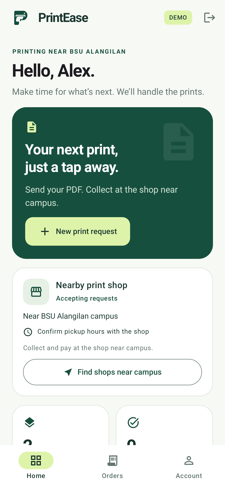
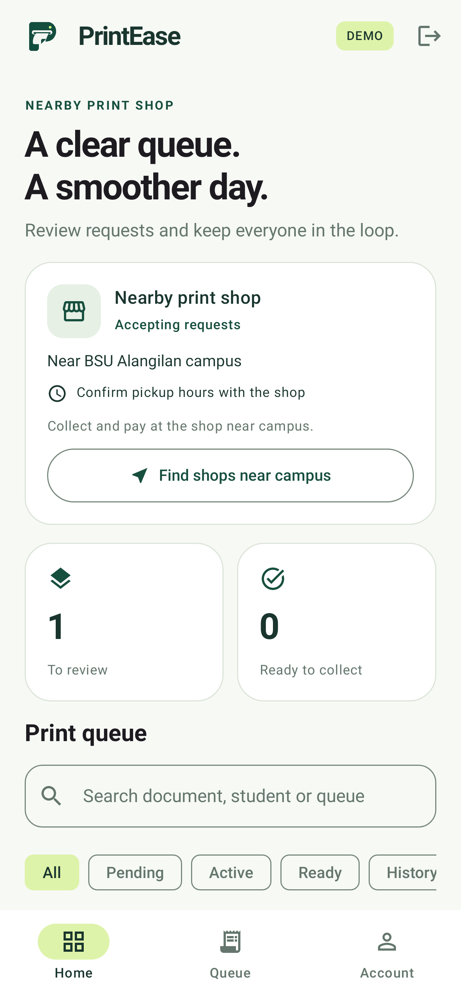

# PrintEase · Native Android

Printing near campus, with less waiting. **Kotlin + Jetpack Compose + Firebase**, developed in Android Studio. Students submit PDFs and follow their orders; shop staff review documents, assign daily queue numbers and update progress.

<p>
  
  
</p>

Screenshots captured from the native Compose app using the Android host test renderer.

## Google sign-in and app logo

Students can use **Continue with Google** to choose their Gmail/Google account without creating a separate PrintEase password. Set up the Google provider, local signing fingerprints and updated configuration using **[Google sign-in setup](docs/GOOGLE_SIGN_IN.md)**. Email/password remains an alternative; Google sign-in is available only in the live variant.

[Preview the Google sign-in screen](docs/screenshots/google-sign-in.png).

The [PrintEase logo](docs/branding/printease-logo.png) is included as a transparent PNG and used in the app header and adaptive launcher icon.

## Use on an iPhone

Open **[PrintEase Web](https://printease-campus.consideratefennel8.chatgpt.site)** in Safari, then use **Share → Add to Home Screen**. The Site is public; use PrintEase’s Google/email sign-in to access your own orders. Live web and Android accounts/orders share the same Firebase project; their local demos remain separate.

The owner must add the deployed hostname under Firebase Authentication’s authorized domains. See **[web setup and checks](web-app/README.md)** for the exact domain, private hosted PDF storage and remaining iPhone checks. The web source is in `web-app/`; the native Android app remains in `app/`.

## Open and run

This Kotlin version is on the **`kotlin-native` branch**. In an existing clone:

```sh
git fetch origin
git switch kotlin-native
```

Open the repository root (the folder with `settings.gradle.kts`) in Android Studio. This is a **native Android project**: no Flutter or Dart SDK is needed. Use Android Studio's embedded JDK 17 or 21, install SDK Platform 35 when prompted, and let Gradle sync.

In **Build → Select Build Variant** (or the Build Variants panel), choose **`demoDebug`**, start an Android emulator or connect an Android 8+ phone, and click Run. The demo works immediately, with no Firebase account, billing or configuration file.

- Student: choose **Continue as student**.
- Administrator: choose **Explore the shop workspace**.
- Switch roles in Account to manage the same demo requests.
- Demo orders and role persist on the device. App data removal/uninstallation resets them.
- Sample orders include previewable PDFs. Upload your own PDF for the full submission flow.

Terminal builds:

```sh
# macOS/Linux
./gradlew :app:assembleDemoDebug
# Windows PowerShell
.\gradlew.bat :app:assembleDemoDebug
```

APK output: `app/build/outputs/apk/demo/debug/app-demo-debug.apk`.

## Connect a real Firebase project

See **[Firebase setup](docs/FIREBASE_SETUP.md)** for the step-by-step console instructions, including the `google-services.json` file you download from Firebase.

Quick version:

1. Register an Android app in your Firebase project with package **`com.printease.printease`**.
2. Save its downloaded configuration as **`app/google-services.json`**. This file is ignored by Git. Do not place it in the repository root or the legacy Flutter folder.
3. Enable Google Authentication (and optionally Email/Password), open/create the default Firestore database in production mode, and deploy the website's private PDF service. New PDFs use Sites managed storage without Firebase Storage billing.
4. Deploy the included Firebase rules to your project. The app enforces student ownership, admin-only management, valid pricing, correct transitions, immutable documents and unique queue assignments.
5. Sync Gradle and select **`liveDebug`**. The demo and live apps have different application IDs, so they can coexist on a device.
6. Sign in with Google or register student accounts in the live app. Create the admin account in Firebase Authentication or by signing in with its Google account first and create `admins/<uid>` with boolean `enabled: true` in Firestore using the project-owner console. Existing `admin` custom claims remain supported. Sign in again afterward.

A missing Firebase configuration produces a setup screen, not a crash or a silent switch to demo. Firebase SDKs are already included; do not paste duplicate Gradle plugins or dependencies from the console.

## What changed from the Flutter prototype

- Native Kotlin application code and Material 3 Compose UI, with light/dark themes, clear text hierarchy, accessible controls, responsive content widths and edge-to-edge insets.
- Student overview, searchable order history, useful empty states, status filters, admin queue and account/price guide.
- System PDF picker; bounded local copy; actual PDF validation/page counting with Android PDF APIs; in-app paged preview and optional external viewer. No broad storage permission needed.
- Saved print drafts survive configuration changes and Android state restoration, including selected PDF, paper, copies, color and duplex options.
- Explicit review step before submission; a fixed action area keeps the submit button reachable; invalid copy counts cannot be submitted.
- Retriable upload progress with a stable request ID. An uncertain write is checked on retry, avoiding duplicate orders and avoiding deletion of documents belonging to successful orders.
- Demo persistence and real sample PDF previews. Explicit demo and live build variants.
- Auth restoration, Google sign-in via Credential Manager, student registration, password reset and admin roles obtained from trusted Firebase custom claims or console-created administrator grants.
- Daily Philippine-time queue counters assigned atomically on acceptance. Server rules prevent number reuse and bind each counter write to the accepted order.
- Rejection reasons, student cancellation while pending, and protected status transitions. Both the client transaction and Firebase rules check the current state.
- Connection/cached-data notices, readable errors, bounded network waits and disabled destructive actions during saves.
- Firebase order schema remains compatible with the original prototype. Deploy updated rules before using cancellation or queue assignment in the new app.

The original Flutter source is preserved in `legacy/flutter/` as a reference. The root project is now the native Android app. The legacy frontend will need corresponding changes before it can use the new counter rules; use the Kotlin live app after deploying the updated rules.

## Structure

```
app/                         Kotlin Android application
  src/main/java/com/printease/app/
    Models.kt                Pricing, orders, workflow, queue sorting
    Documents.kt             Bounded PDF import, validation and rendering
    Repository.kt            Persistent demo and Firebase repositories
    PrintViewModel.kt        Session-aware state, drafts and actions
    Screens.kt               Compose screens and PDF preview
    Theme.kt                 Light/dark theme
  src/test/                  Model, repository/PDF and Compose tests
firebase/                    Firestore/Storage rules and emulator tests
tools/set-admin.cjs          Trusted admin provisioning helper
docs/                        Setup and verification notes
legacy/flutter/              Preserved original Flutter app
```

## Validation

```sh
./gradlew :app:testDemoDebugUnitTest :app:lintDemoDebug :app:assembleDemoDebug
npm ci
npm run test:rules
```

Host tests use Robolectric (Android 34 for Compose and Android 35 for repositories); the first run downloads its Android runtime. Compose tests cover starting a print, search empty states, rejection validation, disabled empty submission and the dark account screen. Screenshots are written under `app/build/screenshots/`. Firebase emulator tests cover private access, spoofing/price tampering, workflow, PDF ownership/type/size, stable-ID retry lookup, cancellation, duplicate queue rejection and simultaneous acceptance.

Android's native PDF engine is not implemented by Robolectric. The separate tests in `app/src/androidTest` validate real PDF page counts, rendering and system-picker import on a connected phone/emulator:

```sh
./gradlew :app:connectedDemoDebugAndroidTest
```

Those device tests require a running Android device; compiling their test APK is not the same as executing them.

## Pricing and limits

Default rates: A4/Letter = PHP 2 B&W or PHP 10 color per printed side; Legal adds PHP 1 per side. Administrators can change whole-peso rates in Account → Manage shop details & rates. Each order keeps its saved rate snapshot. The estimate is `selected pages × copies × saved rate`; duplex saves sheets (`ceil(selected pages/2) × copies`) without reducing printed-side charges.

The administrator verifies the document and page count before acceptance. Firebase rules validate the formula, but PDF page count is client-provided; strict server-side PDF inspection would need a trusted backend. Payment and printing are manual. Direct printing and payment happen at the nearby shop; there is no direct printer integration, online payment or multi-shop marketplace. Statuses update through Firestore while the app is active. Optional Android background pickup alerts require the supplied server function to be deployed; the web companion provides in-app updates.

Live orders currently load up to 500 records per account/shop and warn at that limit. Plan pagination/archive policy for longer deployments. Live uploads need connectivity. Interrupted uploads may leave orphaned objects that require administrator maintenance. The optional retention function removes only expired completed PDFs; it does not remove unreferenced uploads. Sensitive local PDFs are private to the app and backups are disabled. Sign-out discards the current draft; demo order files remain until app data is cleared.

Do not use debug builds as a production release. Configure your own release signing key and run the two-device Wi-Fi/cellular checks in `docs/VERIFICATION.md` before a real deployment. This migration does not promise that every possible bug has been eliminated.

## Shop experience update (2.1)

Printing happens at a partner shop **near campus**. The temporary display name is **Nearby print shop**. Administrators can edit pickup details, whole-peso print rates, request availability and optional completed-PDF retention. Requests support selected page ranges and keep a price snapshot even after rates change. Android pickup alerts are opt-in; server functions must be deployed to deliver them.

See [Shop operations and activation](docs/SHOP_OPERATIONS.md) for the setup steps and shared Android/web behavior. Automatic PDF cleanup is off by default.

## Upload repair 2.2

The current source fixes iPhone picker focus resets, Safari autofill submission, hidden form failures and local-draft storage failures. New private PDFs use the hosted Worker instead of an unprovisioned Firebase Storage bucket. Follow [Firebase setup](docs/FIREBASE_SETUP.md) and [web deployment](web-app/README.md); a GitHub commit is separate from publishing the live Site. See [repair status](docs/WEB_REPAIR_STATUS.md) for deployment limits.
